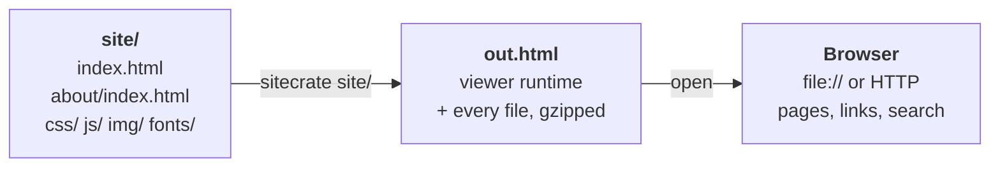

# sitecrate

Packs a complete static site into a single HTML file.

The output is one self-contained `.html` file holding every page, stylesheet,
script, image and font of the site. It opens straight from disk (`file://`) or
from any web server, with no extraction step and no server-side support.
Navigation between pages, back/forward, deep links and site search keep working
inside the file.



## Install

Prebuilt binaries for Linux, macOS and Windows are attached to each
[release](https://github.com/blackshieldpt/sitecrate/releases), with a
`SHA256SUMS` file. To build from source, which requires Go 1.23 or later:

```sh
go install github.com/blackshieldpt/sitecrate/cmd/sitecrate@latest
```

or, from a checkout, `make build`.

## Usage

```sh
sitecrate <site-dir> [-o out.html] [-entry index.html]
```

| Flag     | Default      | Meaning                                         |
|----------|--------------|--------------------------------------------------|
| `-o`     | `out.html`   | Output file.                                     |
| `-entry` | `index.html` | HTML page shown first, relative to `<site-dir>`. |
| `-version` |            | Print the version and exit.                      |

Flags may come before or after `<site-dir>`.

```sh
sitecrate ./public -o docs.html
```

`<site-dir>` is treated as the site root, so root-relative URLs such as
`/css/site.css` resolve inside it.

What is packed:

- every regular file under `<site-dir>`;
- symlinks to files are followed; symlinked directories are not, except
  `<site-dir>` itself;
- files and directories whose name starts with `.` are skipped;
- files whose name is not valid UTF-8 are skipped, with a warning;
- the output file itself is skipped if it lives inside `<site-dir>`.

Warnings about features that may not work in the packed output go to stderr,
one line per feature. The output file is replaced only when packing succeeds.
The exit status is 0 on success, 1 on error and 2 on bad usage.

## Linking into a packed site

Each page has an address inside the file, carried in the URL fragment:

```
out.html#/docs/guide.html
out.html#/docs/guide.html#install
out.html#/search.html?q=term
```

These can be bookmarked, shared and opened in a new tab.

## How it works

**Packing.** The CLI walks the site, concatenates the files, appends a JSON
manifest (path, MIME type, size), gzips the result and embeds it as base64 in a
`<script type="application/octet-stream">` element, next to a small JavaScript
runtime. The site's files are stored unmodified.

**Viewing.** The runtime inflates the payload with `DecompressionStream`, then
renders the requested page in a full-window iframe. All rewriting happens in the
browser, when a page is first shown:

- assets (`src`, `link href`, `srcset`, `poster`, `object data`) become blob URLs;
- `url()`, `@import` and `image-set()` in stylesheets, `<style>` elements and
  `style` attributes are rewritten the same way;
- links to other pages become routes of the form shown above.

## What works

- Multi-page navigation, back/forward, deep links, anchors and page titles.
- Relative, root-relative and directory URLs (`about/` resolves to
  `about/index.html`, `/guide` to `guide.html` or `guide/index.html`).
- Query strings and fragments on asset URLs (`style.css?v=3`, `font.woff2#iefix`).
- `<base href>` and `<meta http-equiv="refresh">` redirects, after their delay.
  Refreshes that reload the page itself are ignored.
- Links created by scripts after the page loads.
- `GET` forms that submit to a page of the site, including the clicked
  button's value and its `formaction`, `formmethod` and `formtarget`.
- Query strings on pages (`location.search`).
- `fetch()` of files of the site, when called with a string URL.
- Search on Sphinx-generated sites.

## Limitations

- `XMLHttpRequest`, web workers and `fetch()` called with a `Request` or `URL`
  object are not redirected to the packed files.
- Relative ES module imports (`import x from "./x.js"`) do not resolve.
- `POST` forms and navigation done from scripts (`location.href = ...`) are not
  handled.
- Pages embedded in another page with `<iframe>` are shown unmodified, so their
  own assets and links do not resolve.
- External SVG references (`<use href="sprite.svg#icon">`) are not rewritten.
- HTML and CSS are read as UTF-8.
- Inside a page, `location` is the address of the packed file, not of the
  original page.
- Resources loaded from other hosts (CDNs, web fonts, analytics) are not
  embedded. They are still fetched at view time and need a network connection.
- `integrity` attributes are removed from rewritten elements.
- The whole site is held in memory while the file is open.

The viewer needs a browser with `DecompressionStream`, which all major engines
have shipped since 2023.

## Development

```sh
make build          # ./sitecrate
make test-go        # go test ./...
make test-js        # runtime unit tests in Node
make test-browser   # runtime tests in Chromium, Firefox and WebKit
make test           # all three
make check          # gofmt and go vet
```

The unit tests need only Node.js. The browser tests open the packed fixture from `file://` and over HTTP with
[Playwright](https://playwright.dev/); the first run installs it and its
browsers. `BROWSERS=chromium make test-browser` limits the
engines.

- `cmd/sitecrate`: command line.
- `sitecrate.go`: `Pack`, the library entry point.
- `walk.go`: finding the files of the site.
- `mime.go`: MIME types by extension.
- `scan.go`: warnings about unsupported features.
- `payload.go`: writing the output file: `shell.html` with the payload and
  the runtime.
- `runtime/`: the in-browser runtime, joined in the order listed in
  `payload.go`: `unpack.js` (payload), `url.js` (resolving references),
  `rewrite.js` (HTML and CSS), `frame.js` (rendering and navigation),
  `main.js` (start-up).
- `testdata/site`: fixture site used by the tests.
- `test/runtime.test.js`: unit tests of the runtime helpers.
- `test/browser.test.js`: browser tests of the runtime.

CI (`.github/workflows/ci.yml`) runs the Go tests on Linux, macOS and Windows
and the runtime tests on Linux. The version lives in `cmd/sitecrate/main.go`.
Pushing a tag `v<version>` runs CI, checks that the tag matches that version,
then runs `make dist` and publishes the archives as a GitHub release; versions
with a `-`, such as `1.0.0-rc.1`, become prereleases.

## Security

See [SECURITY.md](SECURITY.md) for how to report a vulnerability and for the
trust model of packed files.

## License

Apache License 2.0. See [LICENSE](LICENSE).
